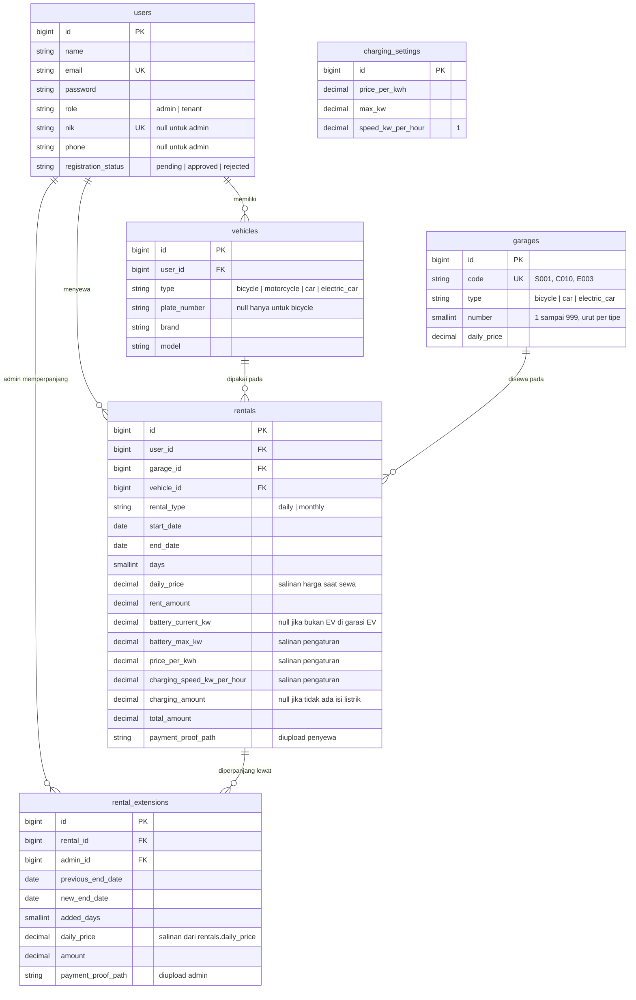

# ERD - Penyewaan Garasi

`charging_settings` berdiri sendiri: satu baris untuk seluruh sistem, tanpa relasi. Penyewaan hanya menyalin nilainya ke `rentals`.

## Penjelasan singkat
- **users**: satu tabel untuk admin dan penyewa, dibedakan kolom `role`. `registration_status` dipakai verifikasi KTP; hanya `approved` yang boleh login.
- **vehicles**: kendaraan milik penyewa, bisa dipakai ulang di beberapa penyewaan. Plat hanya kosong untuk sepeda.
- **garages**: `code` dibuat dari awalan tipe (S/C/E) + `number` 3 digit. Ketersediaan tidak disimpan; dihitung dari tanggal pada `rentals` dan `rental_extensions`.
- **rentals**: satu baris per penyewaan. Harga dan pengaturan isi listrik disalin ke baris ini supaya invoice lama tidak berubah. Kolom baterai dan isi listrik kosong kecuali mobil listrik di garasi mobil listrik. `end_date` selalu berisi tanggal selesai terbaru (setelah perpanjangan).
- **rental_extensions**: riwayat perpanjangan oleh admin, termasuk biaya tambahan dan bukti bayar.
