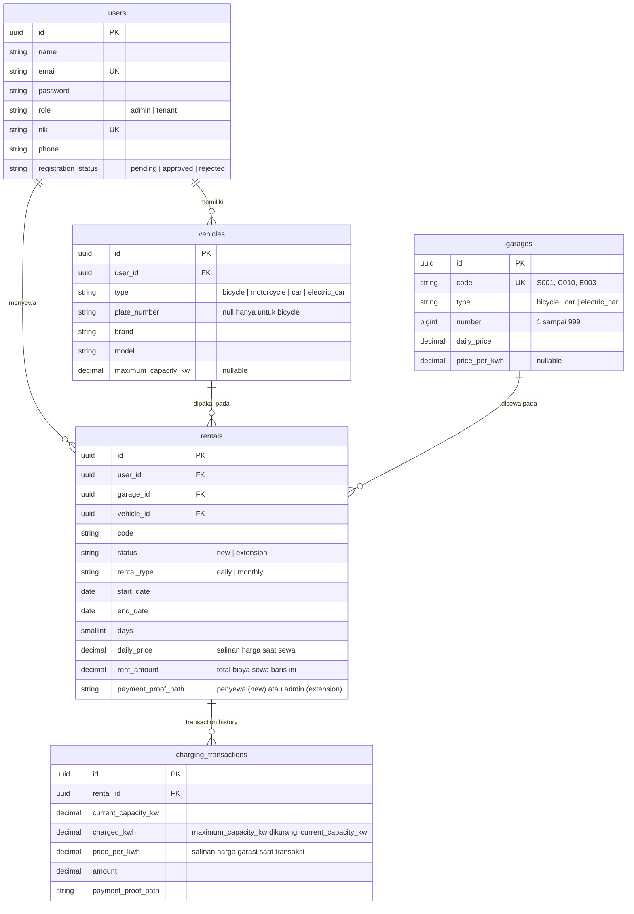

# ERD - Penyewaan Garasi

## Penjelasan singkat
- **users**: satu tabel untuk admin dan penyewa, dibedakan kolom `role`. `registration_status` dipakai verifikasi KTP; hanya `approved` yang boleh login. Nilai yang diizinkan memakai konstanta (lihat bagian Konstanta), dan boleh diberi default di migration (misalnya `registration_status` = pending).
- **vehicles**: kendaraan milik penyewa, bisa dipakai ulang di beberapa penyewaan. Plat hanya kosong untuk sepeda. `maximum_capacity_kw` hanya diisi untuk mobil listrik (kapasitas baterai maksimum dalam kW, diisi penyewa saat mendaftarkan kendaraan).
- **garages**: `code` dibuat dari awalan tipe (S/C/E) + `number` 3 digit. `price_per_kwh` hanya diisi untuk garasi mobil listrik (admin mengisinya saat membuat batch). Ketersediaan tidak disimpan; dihitung dari tanggal pada `rentals`.
- **rentals**: satu baris per penyewaan, dan sewa baru hanya membayar biaya sewa garasi. Kolom `code` berformat `RNT-YYYYMMDD-NNNN` (tanggal pembuatan + nomor urut 4 digit per hari, contoh `RNT-20261121-0001`), dibuat aplikasi saat sewa baru dan disalin ke setiap perpanjangannya, sehingga sewa dan perpanjangannya dicocokkan dengan `code` yang sama (tanpa `parent_rental_id`). Aturan unik: `unique(code, start_date)`, jadi satu `code` tidak boleh punya dua baris dengan tanggal mulai yang sama (mencegah perpanjangan tersimpan dua kali). Index biasa pada `code` untuk pencarian. Perpanjangan disimpan sebagai baris baru dengan `status = extension`: `start_date` adalah sehari setelah tanggal selesai sebelumnya, `end_date` adalah tanggal selesai baru, `rent_amount` adalah biaya tambahan (jumlah hari tambahan x `daily_price`), dan bukti bayar diupload admin. Baris dengan `status = new` dihitung sebagai penyewaan baru di laporan. Tanggal selesai terbaru sebuah garasi adalah `end_date` terbesar pada barisnya.
- **charging_transactions**: riwayat isi listrik, `rental_id` menunjuk baris `rentals` dengan `status = new` (bukan baris perpanjangan), boleh dibuat berulang selama penyewaan garasi mobil listrik sedang berjalan. Setiap transaksi punya bukti bayar sendiri. `charged_kwh` = `vehicles.maximum_capacity_kw` - `current_capacity_kw`, `amount` = `charged_kwh` x `price_per_kwh`. Harga dan jumlah disimpan supaya riwayat lama tidak berubah.

## Perilaku hapus (foreign key)
- `rentals.user_id`, `rentals.garage_id`, `rentals.vehicle_id` dan `charging_transactions.rental_id` memakai **restrict**: riwayat keuangan tidak boleh terhapus tanpa sengaja.
- Semua foreign key lain (misalnya `vehicles.user_id` dan `sessions.user_id`) memakai **cascade** untuk hapus dan ubah.

## Konstanta
Nilai yang diizinkan disimpan sebagai `public const` string di `app/Utilities/Constants/` (gaya sama dengan `Const_Date`), bukan PHP enum dan bukan kolom enum database. Kolomnya string biasa. Konstanta dikelompokkan menurut jenisnya: semua role di `Const_Role`, semua status di `Const_Status`, semua tipe di `Const_Type`. Di `Const_Type`, nama diberi awalan sesuai asalnya (VEHICLE_, GARAGE_, RENTAL_) agar jelas dan tidak tertukar.
- `Const_Role`: `ADMIN` = admin, `TENANT` = tenant
- `Const_Status`: `PENDING` = pending, `APPROVED` = approved, `REJECTED` = rejected (registrasi penyewa), `NEW` = new, `EXTENSION` = extension (rentals)
- `Const_Type`:
  - `VEHICLE_BICYCLE`, `VEHICLE_MOTORCYCLE`, `VEHICLE_CAR`, `VEHICLE_ELECTRIC_CAR` (nilai: bicycle, motorcycle, car, electric_car)
  - `GARAGE_BICYCLE`, `GARAGE_CAR`, `GARAGE_ELECTRIC_CAR` (nilai: bicycle, car, electric_car)
  - `RENTAL_DAILY`, `RENTAL_MONTHLY` (nilai: daily, monthly)
