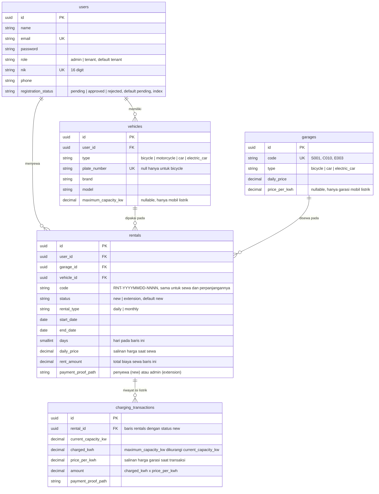

# ERD - Penyewaan Garasi

## Aturan unik dan index
- `users`: unik pada `email` dan `nik`; index pada `registration_status` (daftar pendaftar per status).
- `vehicles`: unik pada `plate_number` (boleh null untuk sepeda).
- `garages`: unik pada `code`.
- `rentals`: unik pada (`code`, `start_date`) sehingga perpanjangan tidak tersimpan dua kali dan pencarian berdasarkan `code` terlayani; index terpisah pada `garage_id`, `start_date` dan `end_date` untuk pengecekan ketersediaan dan tabrakan perpanjangan.

## Perilaku hapus dan ubah (foreign key)
- `rentals.user_id`, `rentals.garage_id`, `rentals.vehicle_id` dan `charging_transactions.rental_id`: restrict untuk hapus (riwayat keuangan tidak boleh hilang).
- `vehicles.user_id`: cascade untuk hapus.
- Semua foreign key memakai restrict untuk ubah (`restrictOnUpdate`).
- Catatan lengkap tabel dan konstanta ada pada bagian "ERD notes" di `.claude/agents/backend.md`.
